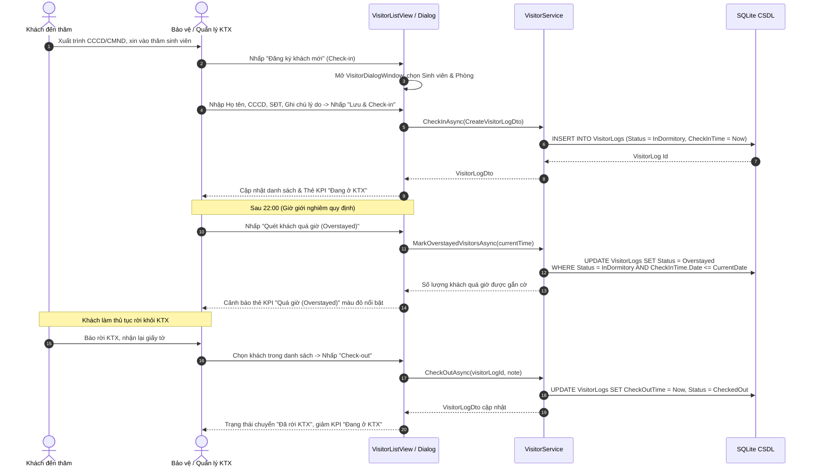
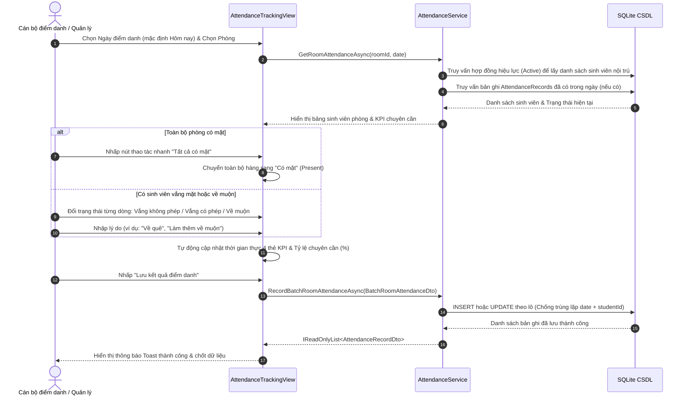
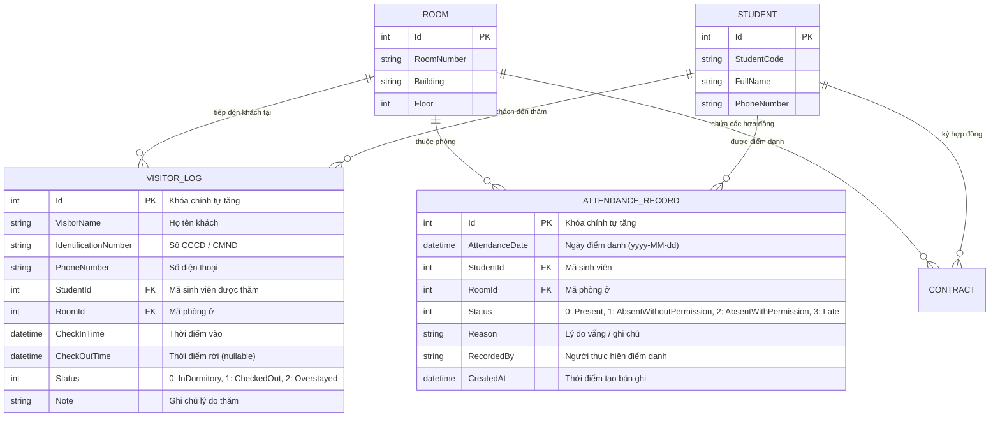

# Đặc Tả Kỹ Thuật: Quản Lý Khách Ra Vào KTX & Điểm Danh Chuyên Cần Ban Đêm (Phase 10)

> **Tài liệu kỹ thuật chính thức** dành cho Phân hệ Kiểm soát An ninh Khách ra vào KTX và Quản lý Điểm danh Chuyên cần Nội trú ban đêm của dự án **Dormitory Manager v2.6.0**.

---

## 1. Giới Thiệu & Bối Cảnh Nghiệp Vụ

### 1.1. Bối cảnh & Mục tiêu
Trong công tác quản lý và vận hành ký túc xá sinh viên quy mô lớn, việc duy trì an ninh trật tự, kiểm soát khách vãng lai và theo dõi sĩ số sinh viên cư trú vào ban đêm là nhiệm vụ trọng tâm của Ban Quản lý và Tổ Bảo vệ KTX. 

Trước phiên bản `v2.6.0`, việc ghi sổ bảo vệ và điểm danh sinh viên buổi tối chủ yếu thực hiện thủ công trên giấy tờ:
- Dễ thất lạc thông tin khách đến thăm, khó truy vết lịch sử khi xảy ra sự cố an ninh hoặc mất mát tài sản.
- Không kiểm soát được khách ở lại quá giờ giới nghiêm ban đêm (22:00), gây tiềm ẩn rủi ro an toàn cho sinh viên nội trú.
- Điểm danh phòng ban đêm ghi sổ tay tốn nhiều thời gian, dễ trùng lặp số liệu, khó tổng hợp báo cáo chuyên cần và tỷ lệ vắng mặt kịp thời để báo cho Nhà trường và Phụ huynh.

Phân hệ **Phase 10: Visitor & Night Attendance Tracking** được phát triển nhằm tự động hóa và số hóa toàn diện hai quy trình nghiệp vụ cốt lõi này trên nền tảng **Clean Architecture** và **Avalonia UI 11 Desktop**.

---

## 2. Quy Trình Nghiệp Vụ Chi Tiết

### 2.1. Quy Trình Kiểm Soát An Ninh Khách Ra Vào KTX



#### Các quy tắc nghiệp vụ kiểm soát khách:
1. **Quy định giờ giấc giới nghiêm (Curfew Policy)**:
   - Khung giờ tiếp khách hợp lệ: **06:00 - 22:00** hàng ngày.
   - Sau **22:00**, mọi khách chưa thực hiện Check-out đều bị xem là vi phạm quy định lưu trú qua đêm của Ký túc xá.
2. **Cơ chế tự động phát hiện quá giờ (`MarkOverstayedVisitorsAsync`)**:
   - Khi chạy chức năng quét (hoặc kích hoạt định kỳ), hệ thống tìm kiếm toàn bộ bản ghi có `Status == VisitorStatus.InDormitory` có thời điểm `CheckInTime.Date <= currentTime.Date` và giờ hiện tại đã vượt qua mốc **22:00:00**.
   - Trạng thái bản ghi tự động chuyển thành `VisitorStatus.Overstayed` và làm nổi bật màu cảnh báo trên giao diện giúp Bảo vệ nhanh chóng xử lý.
3. **Tra cứu & Tìm kiếm đa năng**:
   - Tìm kiếm nhanh tức thời theo Tên khách, CCCD, Số điện thoại hoặc Tên sinh viên được thăm.
   - Bộ lọc theo phòng, theo trạng thái (`Tất cả`, `Trong KTX`, `Đã rời KTX`, `Quá giờ`), lọc theo khoảng ngày đến thăm.

---

### 2.2. Quy Trình Điểm Danh Chuyên Cần Ban Đêm Theo Phòng



#### Các quy tắc nghiệp vụ điểm danh phòng:
1. **Tự động liên kết danh sách cư trú hợp lệ**:
   - Khi chọn một phòng, hệ thống tự động lọc danh sách sinh viên đang có hợp đồng thuê phòng hiệu lực (`ContractStatus.Active`) tại phòng đó.
2. **4 trạng thái điểm danh chuẩn mực**:
   - `Present` (Có mặt): Sinh viên có mặt trong phòng tại thời điểm kiểm tra.
   - `AbsentWithoutPermission` (Vắng không phép): Sinh viên vắng mặt không báo trước, không có đơn xin phép.
   - `AbsentWithPermission` (Vắng có phép): Sinh viên có đơn nghỉ phép hợp lệ được phê duyệt (về quê, đi thực tập, nằm viện,...).
   - `Late` (Về muộn): Sinh viên về phòng sau giờ đóng cửa KTX có lý do chính đáng hoặc cần ghi nhận theo dõi.
3. **Cơ chế chống trùng lặp dữ liệu trong ngày (Idempotent Date Recording)**:
   - Ràng buộc toàn vẹn: Một sinh viên chỉ có tối đa một bản ghi điểm danh trong một ngày lịch (`AttendanceDate.Date`).
   - Nếu cán bộ thực hiện điểm danh lại cùng một phòng trong ngày, hệ thống sẽ thực hiện cập nhật (`UPDATE`) trạng thái và lý do của bản ghi sẵn có thay vì tạo bản ghi trùng lặp (`INSERT`), bảo toàn tính toàn vẹn số liệu thống kê.
4. **Tính toán KPI chuyên cần thời gian thực**:
   - Ngay khi người dùng thay đổi trạng thái của bất kỳ sinh viên nào trên bảng, ViewModel lập tức tính lại:
     $$\text{Tỷ lệ chuyên cần (\%)} = \frac{\text{Số SV Có mặt} + \text{Số SV Về muộn}}{\text{Tổng số SV}} \times 100\%$$
   - Cung cấp phản hồi trực quan tức thì trước khi người dùng nhấn nút lưu vào CSDL.

---

## 3. Thiết Kế Kiến Trúc & Cơ Sở Dữ Liệu

### 3.1. Sơ Đồ Thực Thể Quan Hệ (ERD)



### 3.2. Cấu Hình EF Core SQLite trong `DormitoryDbContext`

```csharp
// Cấu hình bảng VisitorLog
modelBuilder.Entity<VisitorLog>(entity =>
{
    entity.ToTable("VisitorLogs");
    entity.HasKey(e => e.Id);
    entity.Property(e => e.VisitorName).IsRequired().HasMaxLength(100);
    entity.Property(e => e.IdentificationNumber).IsRequired().HasMaxLength(20);
    entity.Property(e => e.PhoneNumber).HasMaxLength(20);
    entity.Property(e => e.Note).HasMaxLength(500);

    entity.HasOne(e => e.Student)
          .WithMany()
          .HasForeignKey(e => e.StudentId)
          .OnDelete(DeleteBehavior.Restrict);

    entity.HasOne(e => e.Room)
          .WithMany()
          .HasForeignKey(e => e.RoomId)
          .OnDelete(DeleteBehavior.Restrict);

    entity.HasIndex(e => e.CheckInTime);
    entity.HasIndex(e => e.Status);
    entity.HasIndex(e => new { e.StudentId, e.CheckInTime });
});

// Cấu hình bảng AttendanceRecord
modelBuilder.Entity<AttendanceRecord>(entity =>
{
    entity.ToTable("AttendanceRecords");
    entity.HasKey(e => e.Id);
    entity.Property(e => e.Reason).HasMaxLength(255);
    entity.Property(e => e.RecordedBy).HasMaxLength(100);

    entity.HasOne(e => e.Student)
          .WithMany()
          .HasForeignKey(e => e.StudentId)
          .OnDelete(DeleteBehavior.Restrict);

    entity.HasOne(e => e.Room)
          .WithMany()
          .HasForeignKey(e => e.RoomId)
          .OnDelete(DeleteBehavior.Restrict);

    entity.HasIndex(e => e.AttendanceDate);
    entity.HasIndex(e => new { e.RoomId, e.AttendanceDate });
    entity.HasIndex(e => new { e.StudentId, e.AttendanceDate }).IsUnique();
});
```

---

## 4. Đặc Tả Giao Diện Lập Trình Ứng Dụng (API Contracts)

### 4.1. Giao Diện `IVisitorService` (Tầng Application)

```csharp
namespace Dormitory.Application.Interfaces;

public interface IVisitorService
{
    /// <summary>
    /// Đăng ký thông tin và ghi nhận lượt khách check-in vào KTX
    /// </summary>
    Task<VisitorLogDto> CheckInAsync(CreateVisitorLogDto dto, CancellationToken cancellationToken = default);

    /// <summary>
    /// Ghi nhận khách check-out rời khỏi ký túc xá
    /// </summary>
    Task<VisitorLogDto> CheckOutAsync(int visitorLogId, string? note = null, CancellationToken cancellationToken = default);

    /// <summary>
    /// Lấy danh sách lượt khách ra vào KTX theo bộ lọc tìm kiếm
    /// </summary>
    Task<IReadOnlyList<VisitorLogDto>> GetVisitorsAsync(VisitorFilterDto filter, CancellationToken cancellationToken = default);

    /// <summary>
    /// Lấy thông tin chi tiết một lượt khách theo mã định danh
    /// </summary>
    Task<VisitorLogDto?> GetVisitorByIdAsync(int id, CancellationToken cancellationToken = default);

    /// <summary>
    /// Quét và tự động đánh dấu các lượt khách đang ở KTX nhưng quá giờ quy định (sau 22:00) thành Overstayed
    /// </summary>
    Task<int> MarkOverstayedVisitorsAsync(DateTime? currentTime = null, CancellationToken cancellationToken = default);

    /// <summary>
    /// Lấy số liệu tổng hợp thống kê lượt khách đến thăm trong ngày
    /// </summary>
    Task<VisitorSummaryDto> GetVisitorSummaryAsync(DateTime? date = null, CancellationToken cancellationToken = default);
}
```

### 4.2. Giao Diện `IAttendanceService` (Tầng Application)

```csharp
namespace Dormitory.Application.Interfaces;

public interface IAttendanceService
{
    /// <summary>
    /// Ghi nhận hoặc cập nhật kết quả điểm danh cho một sinh viên cụ thể trong ngày
    /// </summary>
    Task<AttendanceRecordDto> RecordSingleAttendanceAsync(
        int studentId,
        int roomId,
        DateTime date,
        AttendanceStatus status,
        string? reason = null,
        string? recordedBy = null,
        CancellationToken cancellationToken = default);

    /// <summary>
    /// Ghi nhận hoặc cập nhật kết quả điểm danh theo lô cho cả phòng sinh viên
    /// </summary>
    Task<IReadOnlyList<AttendanceRecordDto>> RecordBatchRoomAttendanceAsync(
        BatchRoomAttendanceDto batchDto,
        CancellationToken cancellationToken = default);

    /// <summary>
    /// Lấy danh sách kết quả điểm danh của một phòng trong ngày chỉ định
    /// </summary>
    Task<IReadOnlyList<AttendanceRecordDto>> GetRoomAttendanceAsync(
        int roomId,
        DateTime date,
        CancellationToken cancellationToken = default);

    /// <summary>
    /// Lấy danh sách bản ghi điểm danh theo bộ lọc tìm kiếm
    /// </summary>
    Task<IReadOnlyList<AttendanceRecordDto>> GetAttendanceRecordsAsync(
        AttendanceFilterDto filter,
        CancellationToken cancellationToken = default);

    /// <summary>
    /// Thống kê kết quả và tính tỷ lệ chuyên cần theo khoảng ngày hoặc phòng
    /// </summary>
    Task<AttendanceStatsDto> GetAttendanceStatsAsync(
        DateTime? fromDate = null,
        DateTime? toDate = null,
        int? roomId = null,
        CancellationToken cancellationToken = default);
}
```

---

## 5. Thiết Kế Tầng Giao Diện Người Dùng (Avalonia MVVM)

### 5.1. `VisitorListViewModel` & `VisitorListView.axaml`
- **Bộ lọc & Tìm kiếm**:
  - `SearchKeyword`: Tìm kiếm từ khóa theo tên khách, CCCD, SĐT.
  - `SelectedStatusFilter`: Lọc trạng thái (`Tất cả`, `Trong KTX`, `Đã rời KTX`, `Quá giờ`).
  - `SelectedRoomFilter`: Lọc theo phòng ở.
  - `FromDate` / `ToDate`: Lọc theo khoảng ngày check-in.
  - `OnlyOverstayed`: Checkbox bật nhanh chỉ xem khách quá giờ.
- **Thẻ KPI thời gian thực**:
  - `ActiveVisitorsCount`: Khách đang có mặt trong KTX (`InDormitory`).
  - `OverstayedCount`: Khách lưu trú quá 22:00 chưa check-out (`Overstayed`).
  - `TotalTodayCount`: Tổng số lượt khách đến thăm trong ngày hôm nay.
  - `CheckedOutTodayCount`: Khách đã rời KTX trong ngày (`CheckedOut`).
- **Các lệnh (RelayCommand)**:
  - `CheckInVisitorCommand`: Mở hộp thoại `VisitorDialogWindow` để đăng ký khách mới.
  - `CheckOutVisitorCommand`: Thực hiện ghi nhận rời KTX cho khách được chọn.
  - `ScanOverstayedCommand`: Kích hoạt quét và đánh dấu khách quá giờ 22:00.
  - `LoadVisitorsCommand`: Nạp lại dữ liệu từ CSDL.

### 5.2. `AttendanceTrackingViewModel` & `AttendanceTrackingView.axaml`
- **Thanh điều khiển điểm danh**:
  - `AttendanceDate`: Chọn ngày điểm danh (mặc định hôm nay).
  - `SelectedRoom`: Chọn phòng cần thực hiện điểm danh.
  - `RecordedBy`: Tên cán bộ/quản lý thực hiện ghi nhận.
- **Danh sách sinh viên nội trú (`StudentAttendanceItemViewModel`)**:
  - Hiển thị danh sách sinh viên đang cư trú trong phòng.
  - Mỗi dòng có `SelectedStatusOption` (ComboBox 4 trạng thái: Có mặt, Vắng không phép, Vắng có phép, Về muộn) và TextBox `Reason` (lý do/ghi chú).
  - Tự động phát sự kiện `StatusChanged` khi thay đổi trạng thái để tính lại KPI.
- **Thao tác nhanh**:
  - `MarkAllPresentCommand`: Chuyển toàn bộ sinh viên trong phòng sang "Có mặt".
  - `MarkAllAbsentCommand`: Chuyển toàn bộ sinh viên trong phòng sang "Vắng không phép".
- **Thẻ KPI chuyên cần phòng**:
  - `TotalStudents`: Tổng sĩ số phòng.
  - `PresentCount`: Số sinh viên có mặt.
  - `AbsentUnexcusedCount`: Số sinh viên vắng không phép.
  - `AbsentExcusedCount`: Số sinh viên vắng có phép.
  - `LateCount`: Số sinh viên về muộn.
  - `AttendanceRate`: Tỷ lệ chuyên cần tính theo phần trăm.
- **Lệnh lưu kết quả**:
  - `SaveAttendanceCommand`: Lưu toàn bộ danh sách điểm danh theo lô xuống CSDL an toàn.

---

## 6. Bảo Mật & Phân Quyền Vai Trò (RBAC)

| Thao tác / Chức năng | Quản trị viên (`Admin`) | Quản lý KTX (`Manager`) | Nhân viên thường |
| :--- | :---: | :---: | :---: |
| **Xem danh sách khách ra vào** | ✅ | ✅ | ❌ |
| **Đăng ký khách mới (Check-in)** | ✅ | ✅ | ❌ |
| **Ghi nhận khách rời KTX (Check-out)** | ✅ | ✅ | ❌ |
| **Quét cảnh báo khách quá giờ (Overstayed)** | ✅ | ✅ | ❌ |
| **Xem bảng điểm danh phòng** | ✅ | ✅ | ❌ |
| **Ghi nhận điểm danh chuyên cần theo lô** | ✅ | ✅ | ❌ |
| **Xem thống kê KPI chuyên cần & khách** | ✅ | ✅ | ❌ |
| **Xóa lịch sử bản ghi an ninh CSDL** | ✅ | ❌ | ❌ |

---

## 7. Đảm Bảo Chất Lượng & Kiểm Thử Tự Động

Phân hệ được kiểm chứng toàn diện qua bộ kiểm thử tự động đạt tỷ lệ **100% Pass**:
1. **Kiểm thử đơn vị & tích hợp (`Dormitory.UnitTests`)**:
   - `VisitorServiceTests`: Kiểm thử check-in, check-out, lọc tìm kiếm, tính KPI và quét khách quá 22:00.
   - `AttendanceServiceTests`: Kiểm thử điểm danh đơn lẻ, điểm danh theo lô cho cả phòng, chống trùng lặp theo ngày (`Idempotency`), tính tỷ lệ chuyên cần.
   - `VisitorListViewModelTests` & `AttendanceTrackingViewModelTests`: Kiểm thử phản ứng dữ liệu, bộ lọc, binding ComboBox, cập nhật KPI và các lệnh RelayCommand.
2. **Kiểm thử giao diện tự động Avalonia Headless (`Dormitory.E2ETests`)**:
   - `VisitorAndAttendanceE2ETests`: 4 kịch bản E2E kiểm tra toàn bộ luồng người dùng:
     * Check-in và Check-out khách thành công.
     * Tự động phát hiện và cảnh báo khách quá giờ 22:00 (`Overstayed`).
     * Điểm danh phòng ban đêm và chống trùng lặp trong ngày.
     * Chuyển đổi điều hướng mượt mà giữa các phân hệ trên Sidebar.
